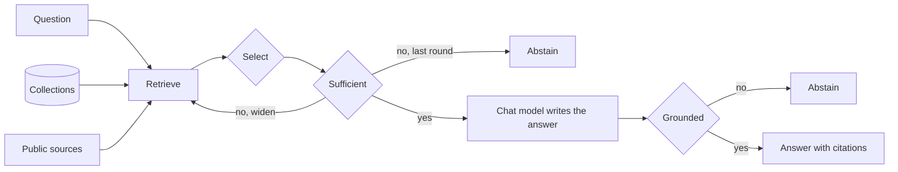

<!-- agent-hint: Front page of the evidencia docs. Keep the page list in the same order as the footers of the other pages. Every fact in these docs must match the code in evidencia/ — config defaults in evidencia/config.py, routes in evidencia/api.py, gate logic in evidencia/pipeline.py, sources in evidencia/sources.py, chat presets in evidencia/generators.py, MCP tools in evidencia/mcp_server.py. -->

# evidencia

evidencia answers questions from your documents and from public Portuguese sources, only when a decision model says that the evidence supports the answer. It is a Python package, an HTTP service, a demo page and an MCP server. It is an in-house research service for European Portuguese (pt-PT).

The decision model answers three yes/no questions:

1. **Select.** Does this passage help to answer the question?
2. **Sufficient.** Is the selected evidence enough to answer? If not, evidencia retrieves more passages and asks again.
3. **Grounded.** Is every fact in the generated answer supported by the evidence?

When a gate fails, evidencia does not answer. Each response gives the probability and the threshold of each gate that ran, so you can audit every decision.

The default decision model is Jevásio-0.8B-v2. Its licence is CC BY-NC-SA 4.0, so a deployment with the default model is for research and non-commercial use only. Refer to [Decision models](decision-models.md). The default chat model is AMALIA, served by llama.cpp. Refer to [Chat models](generators.md).

## Pages

Read the pages in this order. Each page links to the next one at its end.

| Page | Contents |
| --- | --- |
| [Step-by-step setup](setup.md) | A guided install for readers who do not program |
| [Getting started](getting-started.md) | Install, start the service, ask a first question |
| [Gates](gates.md) | How the three gates decide, the retrieval rounds, and what each abstention means |
| [Decision models](decision-models.md) | The models, their licences, and the HTTP and in-process backends |
| [Chat models](generators.md) | AMALIA, Claude, OpenAI, OpenRouter, OpenCode, Ollama and API keys |
| [Documents](documents.md) | Formats, passages, persistence, hybrid retrieval and near-duplicates |
| [Public sources](sources.md) | The twenty-one public sources, their licences, and how they are searched |
| [Agents](agents.md) | Connect Claude Desktop, Claude Code or OpenCode through MCP |
| [Demo page](demo.md) | The web page that shows each gate decide |
| [HTTP API](api.md) | Every endpoint, with request and response examples |
| [OpenAI compatibility](openai-compat.md) | Chat completions and vector store search for OpenAI clients |
| [Configuration](configuration.md) | Every setting and environment variable |
| [Deployment](deployment.md) | Containers, AMALIA in compose, authentication and health checks |
| [Python](python.md) | Use evidencia as a library |
| [Evaluation](evaluation.md) | The pt-PT gate cases and the measurement scripts |
| [Troubleshooting](troubleshooting.md) | Each error message and its fix |

---
[Step-by-step setup →](setup.md)
